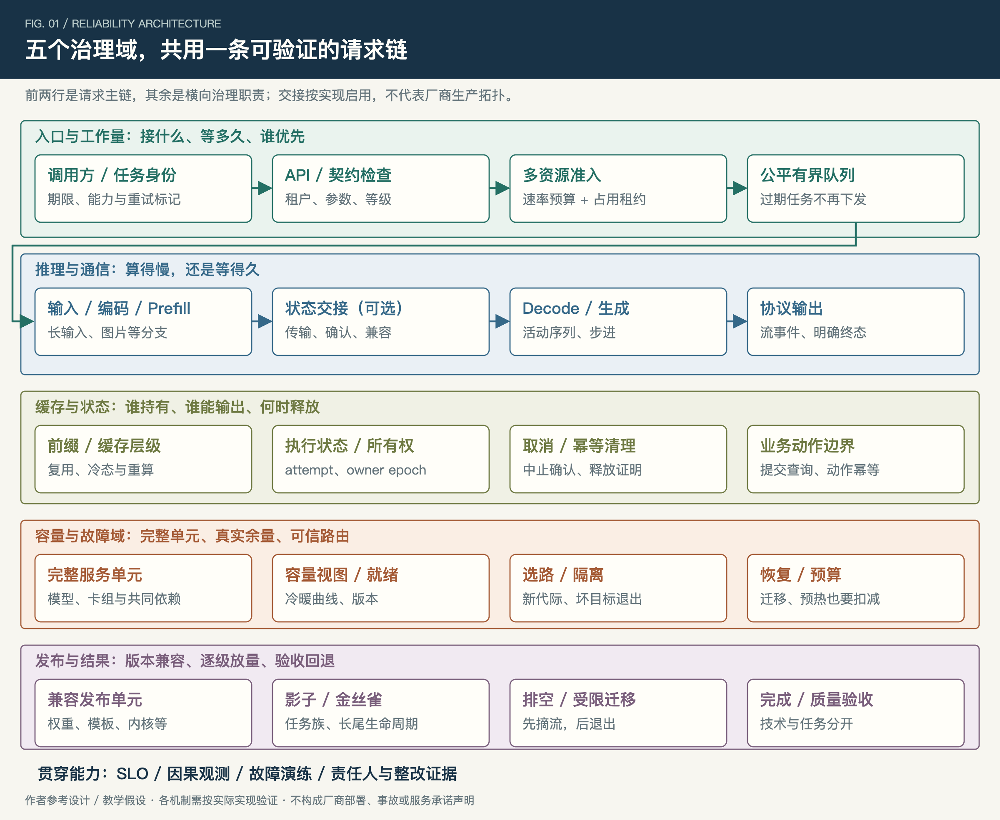
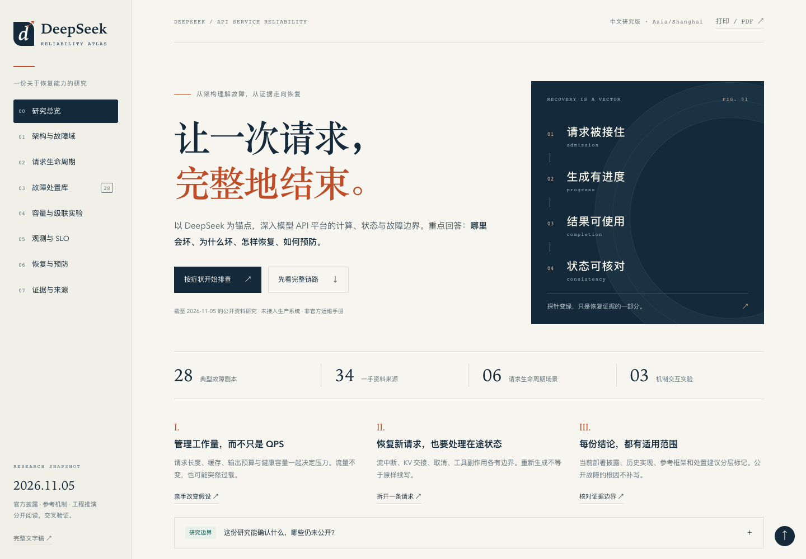
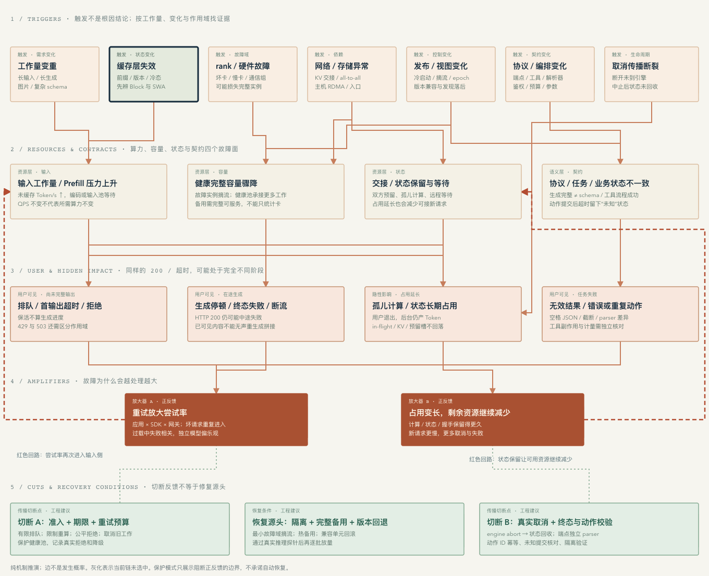

# ds-api-research

## 大模型 API 平台的架构与稳定性保障方案

从 DeepSeek API 研究出发，结合 Kimi／Mooncake、智谱、千问／阿里云百炼等公开资料，讨论大模型 API 平台如何识别故障、限制影响、恢复服务，并通过架构反查推动稳定性治理。

这里收录技术文章、交互研究页面、架构与故障图、快速处置表、反查清单和来源台账。面向大模型平台的技术经理、稳定性架构师、SRE 负责人，以及负责 API 接入、推理服务、调度、缓存和模型发布的工程师。

> 本项目为非官方工程研究，与文中厂商无隶属或背书关系。公开事实、参考实现、工程建议与教学假设分别表达；图示和故障推演不代表任何厂商的完整生产拓扑、实际事故或能力评价。欢迎讨论、纠正与补充。

**先读 [技术文章](article_info/article.md)，快速查阅 [排查与止血表](article_info/quick-triage.md)，组织评审使用 [架构反查表](article_info/stability-audit.md)。**

## 我们关注什么

大模型 API 的稳定性，需要同时关注**工作量、在途状态和故障域**，并在明确的服务边界内验证合格任务是否完整完成。

本研究围绕以下问题展开：

- 为什么 QPS 不变，输入变长或缓存变冷，平台仍会过载？
- 为什么 HTTP 200、连接保活、进程健康，都不足以证明任务可用？
- 如何区分排队、输入计算、状态交接、生成、通信与客户端交付的问题？
- 客户端取消以后，怎样确认计算停止、状态回收和预算归还？
- 单卡、通信组、缓存或共享依赖出问题时，应该隔离多大范围？
- 实例数量恢复后，凭什么判断可以重新放开流量？
- 如何把这些问题转成有责任人、验收条件和证据的治理项？

### 架构概览



五个治理域贯穿同一条请求链：

| 治理域 | 核心问题 | 重点机制 |
| --- | --- | --- |
| 入口与负载 | 哪些工作可以进入，能等多久？ | 工作量预算、占用租约、公平队列、期限与重试 |
| 执行与通信 | 算得慢、等得久，还是整个执行域失去进展？ | 阶段观测、进度探针、通信诊断与最小安全域隔离 |
| 缓存与状态 | 谁持有状态，谁能输出，何时可以释放？ | 冷态重算预算、交接所有权、取消与幂等清理 |
| 容量与路由 | 故障之后还剩多少真实可服务能力？ | 完整单元、冷热容量曲线、代际校验与分批接流 |
| 发布与结果 | 如何更新、回退，并确认结果仍然可用？ | 兼容组合、灰度排空、协议终态与任务验收 |

鉴权、额度、配置发现、状态存储、计量和遥测等共享依赖，以及 SLO、观测、演练与整改闭环，横跨这些治理域。

## 从哪里开始

| 你的目的 | 推荐入口 | 可以获得什么 |
| --- | --- | --- |
| 系统理解稳定性架构 | [技术文章](article_info/article.md) | 五域框架、共享依赖、六阶段故障处置推演与术语 |
| 按现象快速找排查方向 | [快速排查与止血表](article_info/quick-triage.md) | 16 项典型问题、判别证据、止血动作及恢复前提 |
| 组织团队架构反查 | [稳定性架构反查表](article_info/stability-audit.md) | 36 项问题、证据要求、整改模板与三项组合演练 |
| 交互探索架构与故障传播 | [交互研究台文件](page_info/index.html) | 下载后用浏览器打开，支持图谱联动、故障筛选与教学实验 |
| 阅读完整故障剧本 | [研究台文字稿](page_info/research.md) | 28 类故障的症状、机制、诊断、止血、恢复、验收与预防 |
| 核对来源及适用范围 | [文章来源台账](article_info/sources.md)／[研究方法](page_info/methodology.md) | 一手来源、证据分层、版本范围与不可外推的结论 |
| 获取文章或演示用图 | [文章配图](article_info/figures/)／[研究台全景图](page_info/diagrams/) | PNG 图片与 SVG 矢量图 |

### 两部分内容的关系

`article_info/` 是面向多家平台的通用稳定性治理文章，当前为 **v2.1**，资料核验日期为 **2026-11-06**。包含 11 张配图、16 项快速处置、36 项反查、24 项术语及 32 项来源。

`page_info/` 是以 DeepSeek 为锚点的交互研究台，研究快照为 **2026-11-05**。包含 13 个架构组件、28 类故障、34 项来源、三个教学实验、14 项观测和 12 类演练。

两者侧重点与编号体系独立：文章中的 F01—F16 和网页中的 F01—F28 不表示相同条目，来源编号也应在各自台账内查阅。研究日期表示资料快照，不表示当前厂商 API 的持续状态。

## 交互研究台

研究台提供以下交互：

- **架构全景**：沿请求、状态与控制关系查看组件职责，点击节点联动相关处置。
- **故障全景**：探索缓存、单卡、取消、发布等传播路径，切换保护模式观察放大回路的切断点。
- **故障处置库**：按症状、组件和关键词筛选 28 类故障，查看判别、恢复、验收与预防。
- **三个教学实验**：调整工作量与缓存、重试层数、完整实例 N−1 等参数，观察假设变化的影响。
- **观测与证据**：查阅 SLO 口径、演练方案、来源登记与证据边界。

全景图支持缩放与全屏；按 `/` 聚焦故障搜索，按 `Esc` 退出全屏。实验数字是教学假设，不能用来推算厂商实际容量、GPU 数量或恢复时长。

<details>
<summary>查看研究台截图与故障全景</summary>





</details>

### 本地打开

克隆仓库后，用浏览器打开 `page_info/index.html`：

```sh
git clone git@github.com:liu-kaining/ds-api-research.git
cd ds-api-research
```

也可以直接下载整个仓库。该 HTML 是自包含文件，样式、脚本与研究数据均已内联；阅读和使用交互无需安装依赖、启动后端或配置 API Key。查看外部来源原文时需要联网。

如果更习惯通过本地 HTTP 服务访问，在仓库根目录运行：

```sh
python3 -m http.server 8000 --bind 127.0.0.1 --directory page_info
```

然后在浏览器打开 `http://127.0.0.1:8000/`。

## 如何用它开展一轮稳定性反查

1. **确定边界**：填写服务、模型、端点、版本、工作负载、故障域及各团队责任。
2. **提交证据**：按反查表整理自身机制、容量曲线、阶段观测、状态回收与演练材料。
3. **明确结论**：使用“待核实／已验证／未通过／不适用”四种状态；缺证据不等于已发生缺陷，也不能直接标为通过。
4. **落实整改**：为每项设置唯一责任人、改造动作、期限、量化验收与独立验收人。
5. **验证与复查**：先验证单项故障，再组合相关条件；版本、任务分布或资源拓扑改变后重新审查。

配套演练覆盖冷缓存与完整单元退出、交接取消与迟到确认、共享依赖失联与恢复积压。请将参考方案适配成自身授权环境中的预案，填写停止条件和回退目标；本文没有提供任何厂商的生产操作权限或内部命令。

## 仓库结构

```text
ds-api-research/
├── README.md
├── article_info/                  # 技术文章与治理工具
│   ├── article.md                 # 正文
│   ├── quick-triage.md            # 16 项快速排查与止血表
│   ├── stability-audit.md         # 36 项架构反查
│   ├── sources.md                 # 文章来源与适用边界
│   ├── figures/                   # 11 张 PNG/SVG 及图稿清单
│   └── docs/verification-v2-1.md   # 文章交付校验记录
└── page_info/                     # DeepSeek API 交互研究台
    ├── index.html                # 自包含单页，可离线打开
    ├── README.md                 # 研究台详细说明
    ├── research.md               # 完整线性文字稿
    ├── methodology.md            # 研究方法与边界
    ├── sources.json              # 结构化来源登记
    ├── diagrams/                 # 架构与故障全景 PNG/SVG
    ├── artifacts/                # 桌面/手机截图与浏览器检查结果
    ├── src/                      # 页面模板、样式、逻辑与研究数据
    ├── tools/build.mjs           # 研究台构建脚本
    ├── tests/                    # 核心逻辑与离线浏览器检查
    ├── docs/plans/               # 原始设计与实施记录
    └── verification-report.md    # 研究台交付验证记录
```

## 修改与验证

### 修改文章

正文、速查表、反查表与来源台账位于 `article_info/`。修改时请同步相关表格、来源编号、配图与图注；图片采用相对路径。`quick-triage.md` 对应正文第十章，应保持内容一致。

文章配图提供 PNG 与 SVG，图稿清单见 [manifest.json](article_info/figures/manifest.json)。本仓库收录的是文章交付文件，未包含原写作环境的文章导出与配图生成脚本。

### 修改研究台

研究台使用原生 HTML、CSS 和 JavaScript，构建依赖 Node.js 20 或更高版本。修改 `page_info/src/` 后，在仓库根目录运行：

```sh
node page_info/tools/build.mjs
node --test page_info/tests/core.test.cjs
```

构建会更新 `page_info/index.html`、`page_info/research.md` 和 `page_info/sources.json`，并检查来源、故障编号、关联关系和必备处置字段。直接修改生成后的 HTML 会在下次构建时被覆盖。

需要复查浏览器交互时，使用 Python 3、Playwright 和已安装的 Google Chrome：

```sh
python3 -m venv .venv
.venv/bin/python -m pip install playwright
.venv/bin/python page_info/tests/browser_smoke.py --channel chrome
```

以上为 macOS／Linux 示例，虚拟环境仅用于本地验证。检查会在断网浏览器上下文中运行，并更新 `page_info/artifacts/` 和 `page_info/diagrams/` 的检查结果、截图与全景图。阅读页面无需安装这些开发工具。

### 验证记录

- [文章校验记录](article_info/docs/verification-v2-1.md)：独立读者审阅、图稿边界、算例、来源与文件一致性等。
- [研究台验证记录](page_info/verification-report.md)：核心逻辑检查与交付时的离线浏览器验证。
- [浏览器逐项结果](page_info/artifacts/browser-checks.json)：交付记录包含 43 项检查，记录了桌面、手机、搜索、图谱、实验与无外部请求等行为。

这些记录说明对应快照下的文档与工具验证情况，不能证明厂商生产稳定性，也不替代自身系统的容量测试和故障演练。

## 资料与适用边界

本研究优先使用原始论文、官方 API 文档、公开代码仓库和服务方披露，并区分：

| 证据类型 | 可以支持什么 | 需要保留的边界 |
| --- | --- | --- |
| 官方披露与 API 契约 | 特定版本、端点和产品模式下的行为 | 不推定未公开的完整生产实现 |
| 论文与参考实现 | 机制、设计取舍及实验条件 | 不等于已在讨论厂商线上采用 |
| 历史快照与公开事件 | 当时披露的影响、状态和设计 | 未披露技术根因的部分保持未知 |
| 作者方案与教学推演 | 有前提的排查、保护、恢复和验证方法 | 不当作真实事故、实测参数或服务承诺 |

项目没有厂商内部拓扑、运行 trace、私有故障日志或真实生产演练数据。阅读与本地测试不调用真实模型 API，不产生模型调用费用。滚动文档可能变化，引用或实施前应重新确认相关契约与版本。

## 讨论与贡献

欢迎通过 Issue 或 Pull Request 补充以下内容：

- 有一手资料支持的事实纠正，并注明版本、日期、端点与适用范围。
- 典型问题的判别证据、止血前提、恢复验收与反例。
- 更清晰的图示、术语解释和阅读路径。
- 可复现的页面问题、计算边界或测试缺口。

提出技术修订时，建议附上“相关章节／条目、问题、来源或复现、建议改法”。涉及真实案例请先脱敏；公开事实和推演结论应分开表达。

引用文章或图片时，请保留项目名称、来源台账，以及图中的“参考设计／教学假设”与适用边界标识。当前仓库未附 `LICENSE` 文件，README 不另行指定许可协议。
