# 大模型 API 平台的架构与稳定性保障方案

## 从工作量、在途状态与故障域出发，建立可反查的治理体系

> 面向大模型公司的技术经理、稳定性架构师与 SRE 负责人。本文为非官方工程讨论，以 DeepSeek、Kimi、智谱、千问／阿里云百炼的公开资料说明不同设计路径；架构图、故障场景与控制方案为作者整理，不代表任何厂商的实际事故、内部拓扑或能力评价。资料核验日期：2026 年 11 月 6 日。欢迎交流、纠正与补充。

一个模型 API 平台，可以在 QPS 没有增长时突然过载：输入变长了、缓存复用下降了，或生成持续时间增加了。它也可能在 HTTP 200 和连接保活都正常时，让用户一直等不到结果；还可能在入口超时以后继续消耗后端资源。

这些现象需要统一的架构解释。否则，“加限流、加机器、加监控”容易成为彼此独立的动作，无法回答故障发生时到底该控制什么。

本文的核心观点是：**围绕工作量、在途状态和故障域建立控制闭环，在声明的服务边界内，以合格任务完整完成作为验收依据。**

据此，可以将稳定性拆成五个治理域：入口与负载、执行与通信、缓存与状态、容量与路由、发布与结果。SLO、因果观测和故障演练贯穿其中。读者应能用这套结构检查自身系统，并形成有负责人、改造动作和验证证据的治理项。

阅读时可以先看架构与各域控制，再用第七章检查共享依赖，第八章跟随一次完整处置，第十章查找典型问题的排查与止血动作。文末附术语介绍；配套反查表用于落实责任人与验收。

## 一、架构全景：五个治理域，连接同一条请求

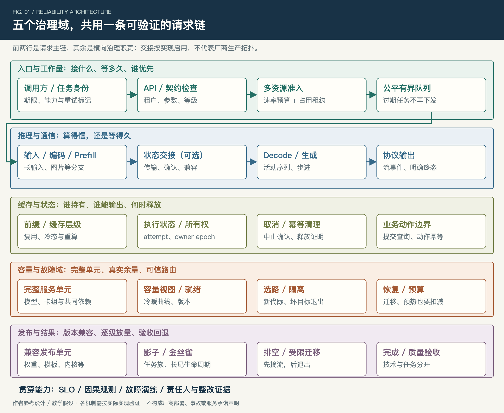

*图 1：五个治理域分别控制工作入口、执行进度、状态生命周期、可服务容量与发布结果。图中职责可以合并或拆分，条件分支按具体能力启用。*

入口识别租户、参数、任务等级与期限；调度判断是否有足够资源完成任务。推理侧通常要处理输入上下文，再持续生成输出，即 Prefill 与 Decode。采用阶段分离时，还会出现中间状态交接。缓存、通信与主机资源横跨这些阶段，控制面则维护实例、版本、路由和容量。

稳定性分析需要沿这条请求链观察，而不能只按组织分工各看一块。首输出慢，可能卡在编码、排队、输入计算或交接；持续输出卡顿，可能来自生成、专家通信，也可能来自代理缓冲与客户端慢读。

不同公开案例可以帮助理解这些关系，但不能直接拼成一家公司的完整实现：

| 公开案例 | 能说明的机制 | 对应的治理问题 |
| --- | --- | --- |
| DeepSeek 的 DeepInfer 部署资料及专家通信项目 | 阶段、并行执行与完整实例约束 | 如何识别执行故障域与恢复单元？[3][4][19][20] |
| Kimi 背景的 Mooncake 论文及开源 Store | KV 资源组织、阶段解耦、元数据和数据路径 | 缓存异常后能否承载重算？选主后何时才算可服务？[1][2] |
| 智谱的错误与 Responses 契约 | 业务错误、流终态及服务端会话状态 | 如何分类恢复，接口切换后状态是否仍正确？[7][8] |
| 千问／百炼的限流、吞吐预留和独占部署模式 | 不同资源承诺及溢出路径 | 配额、预留、隔离和容灾分别由什么证据支持？[9]—[12] |

论文、开源实现与 API 契约是不同层次的证据。本文借鉴它们提出问题，以下控制方案仍需在具体模型、硬件和产品模式下验证。

### 先把“请求结束”定义清楚

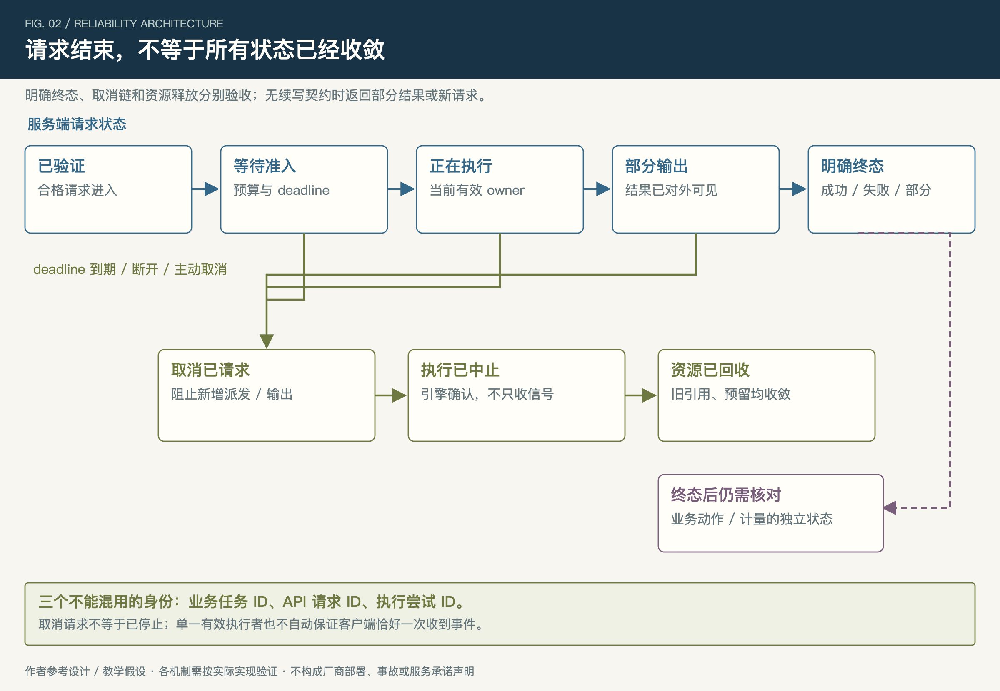

*图 2：业务任务、API 请求和执行尝试需要不同身份。连接关闭、取消收到、计算停止和资源回收不是同一个事件。*

一条请求可能经历等待、执行、部分输出和明确终态；取消可以发生在多个阶段。入口停止等待以后，后端不一定已经停止。产生了部分输出以后，重新生成也不等于原任务连续恢复。

建议至少区分三个身份：调用方的业务任务 ID、服务方的 API 请求 ID，以及每次实际执行的 attempt ID。实例换代还要有执行者代际，状态转移则需要所有权标识。它们用于解决不同问题，不能用一个 request ID 包办重试、迁移和业务幂等。

下文讨论每个治理域时，都沿着“识别异常—实施保护—恢复服务—验证状态”的顺序展开。

## 二、治理域一：入口与负载——让准入真正理解工作量

### 1. 两类账本，不能混成一个并发数

第一类是**工作量预算**：输入计算、生成执行、传输、视觉或编译等工作，在一个调度窗口内允许进入多少。第二类是**瞬时占用预算**：活动序列、执行状态、输出缓冲和交接预留，最多允许持有多少。

Token/s 与状态 bytes 不能互换。缓存命中高，能够减少部分输入计算，却不意味着活动请求不再生成、不再持有状态。生成变长还会延长占用时间。

在稳定、匹配的统计边界下，平均在途数满足 `L = λW`。每秒 100 个请求、平均停留 10 秒，对应约 1,000 个在途；若停留变为 30 秒，则约为 3,000。这个关系用于解释占用，不用于证明持续积压的系统仍有稳定容量。

输入侧可以先用未缓存 Token 估计工作量。例如，100 请求/秒、平均 8,000 输入 Token，Token 加权命中率从 90% 降至 50%，未缓存量从 80,000 变为 400,000 Token/s。它是工作量代理，不是跨模型通用 FLOPs；真实成本仍要由同分布测量校准。

### 2. 一个能实现的准入闭环

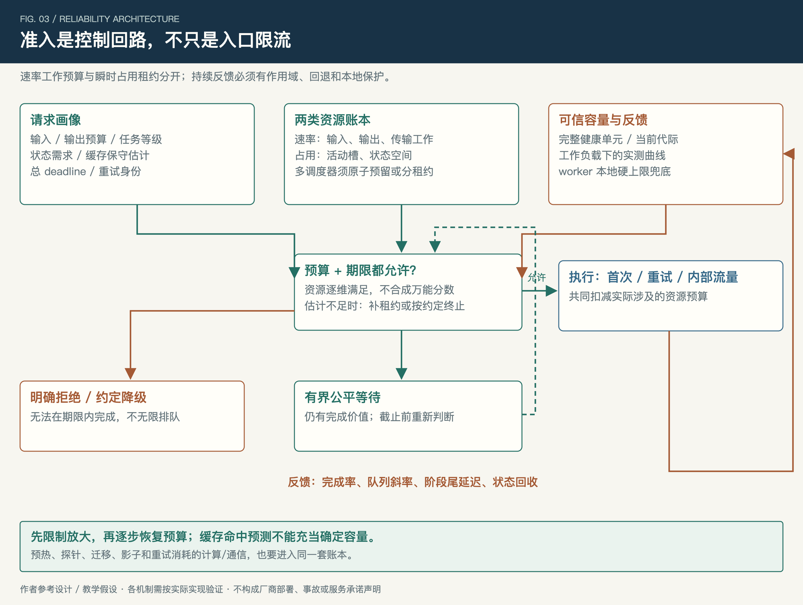

*图 3：容量遥测提供判断依据；原子预留或总量受控的额度租约防止超卖，worker 本地保护负责最后一道约束。*

建议的控制过程是：

```text
校验参数、任务等级与硬预算；形成保守资源估计
检查剩余 deadline 是否仍允许完成
在租户与目标阶段逐维申请工作额度、占用租约
申请成功 → 带 attempt、执行者代际与 deadline 派发
暂时不足 → 进入仍有完成价值的有界公平队列
无法及时完成 → 明确拒绝或进入约定降级
执行中 → 按实际工作校正估计，提前续租或申请追加额度
确认终止后 → 释放实际持有资源，完成账本对账
```

逐维申请还需要明确提交边界：全部必要预留确认后才派发，任一失败则撤销本轮部分预留，进入队列后重新申请，避免持有一部分资源等待另一部分。申请或撤销响应丢失时，应能凭 reservation ID 查询、幂等撤销和对账，不能直接重发一份新预留。

这里还有三个实现难点。

**输出长度在入口未知。** 可以按任务族和硬上限做分位估计，运行中追加预算；也可以为严格服务等级按更保守上限预留。但不能只保留平均需求，又承诺任何长尾都按时完成。追加应早于预算耗尽；如果不足，要优先约束新准入，并按契约处理在途任务，不能静默截断后仍报完整成功。

**多调度器会读到同一份余量。** 只靠容量快照可能超卖。可以用原子预留，也可以下发总和受控、有代际和有效期的额度。旧、新代际中仍可消费的额度必须共同入账，不能确认撤销的额度不得再次发放。容量收缩时停止追加，按预先声明的策略处理存量承诺；不能只更新 epoch 就认定旧额度已失效。租约到期用于失效与隔离判断，不能直接证明物理计算已停止，后端资源仍需对账。

**控制器会振荡。** 队列变长就扩准入、P99 变差又急降，可能造成反复冲击。采样窗口、迟滞、变化限速和探测流量要结合任务周期设置。阈值来自该工作负载的容量曲线，不采用通用 GPU 百分比作为万能开关。

### 3. 重试必须重新经过准入

异常分类至少应包含端点、业务错误、作用域和发生阶段。同为 HTTP 429，Kimi 公开契约区分引擎过载、组织限额及额度问题；智谱也区分账户限流、平台过载和欠费。[5][7] 它们需要不同处理，不能统一“等一秒再试”。

重试预算要声明分母：若 `重试数 / 原始请求数 ≤ b`，则总尝试数最多为原始请求的 `1+b` 倍。这只约束次数，昂贵重试仍需另扣工作量。应用、SDK、网关应确定责任层，共享总期限，避免重复放大。[16]

出现过载时，先控制低优先级新增工作和重试，再恢复瓶颈资源；恢复后以队列斜率、分组延迟和完成率逐步调回预算。预热、迁移和影子请求也消耗资源，不能作为准入旁路。

**本域反查：** 相同 QPS 下输入变长或复用下降，哪份预算先变化？多个调度器如何防超卖？输出超过预测后怎么处理？需要拿出成本误差、预留日志和联合负载回放，而不是仅提供限流配置。

## 三、治理域二：执行与通信——把故障定位到可处理的最小范围

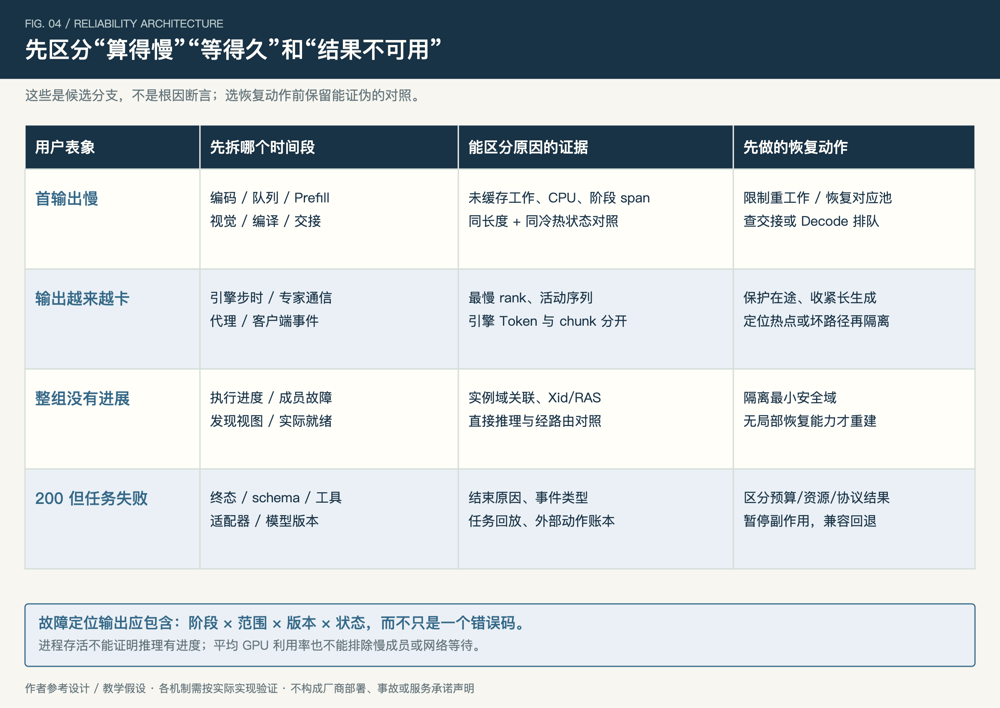

*图 4：每一种表象都保留多个候选原因。恢复动作由阶段与作用域证据决定。*

### 1. 建立两条时间链

首输出链是：入口预处理、等待、Prefill、状态交接、Decode 首步、客户端可见。持续输出链是：计算步、并行通信、输出解析与缓冲、客户端读取。

这样才能区分“算得慢”和“等得久”。如果 Prefill 已结束、Decode 首步仍未发生，采用 P/D 分离时先核对交接；交接已确认或未采用分离时，检查 Decode 排队与首步进度。如果引擎稳定但客户端成批收到内容，应看代理和慢读背压，而不是先重建 GPU。

Prefill/Decode 分离有利于分别规划输入与输出资源，也增加了传输和生命周期管理责任。DistServe 和 Mooncake 从不同角度讨论过这种设计取舍。[17][1] 对采用此模式的平台，交接必须成为独立观测和演练对象。

### 2. 进程健康、推理进度与任务可用分层判断

建议分四层探测：进程活性、关键运行依赖、真实执行进度、代表性任务完成。每层用于回答不同问题，不能把“端口可连”作为推理就绪。

执行进度要能关联实例、通信组、rank 和版本。MoE 的请求级路由与实例内专家路由是不同层次：请求数均衡，不代表专家工作均衡；平均 GPU 指标正常，也可能有单个慢成员拖住同步步骤。DeepEP 与 EPLB 的公开项目分别说明通信与专家放置职责，不能把热点专家副本当作独立服务备用。[19][20]

若确认是硬件或通信域异常，应先根据实际依赖关系确定最小安全隔离范围。已验证能够独立恢复的卡、成员或路径，可以局部隔离；若同步通信组无法继续推进，或局部恢复能力未经验证，再停止该完整服务单元的新派发，保留现场并按受支持流程重建。若是专家工作量偏斜，应在有效配置内调整放置或副本，并同时检验通信代价；不能因为负载更均匀就认定最终延迟更好。

### 3. 恢复入口要带条件

一个可操作的隔离流程包括：确认作用域、停止新派发、按状态处理在途、验证替代容量、修复或重建、预热、逐级接流。再次出现无进度、旧成员被选中或任务不合格，就停止放量。

DeepSeek 的特定部署问答描述了大 EP 实例中的成员故障约束。[4] 可推广的反查方法是确定自身真正的故障单位，而不是假定所有模型都按单 GPU 恢复。

此外，客户端慢读需要有界输出缓冲。若超过约定背压预算，应明确部分结果或连接终止，同时触发后端取消。无限缓冲会让原本属于接入路径的问题转化为进程内存压力。

**本域反查：** 能否用同一个请求区分编码、等待、计算、交接和传输？进程活着但不产出时谁摘流？慢 rank、专家热点和网络等待如何证伪？证据应包括阶段 trace、进度及最小域演练。

## 四、治理域三：缓存与状态——把复用、迁移和回收分开设计

### 1. 缓存异常先分类，再决定回退

缓存复用下降可能来自正常输入变化、冷态、命名空间变更、索引滞后、存储读异常或隔离问题。它们不能统一处理为“清缓存后重算”。

前缀与版本变了，应检查复用键和兼容边界；存储异常，应隔离已证实坏路径；预测命中却读不到，应修正路由视图和成本估计；隔离正确性可疑，应先阻断可疑复用。任何回退重算都需要冷态承载预算。

API 缓存字段可以帮助观察复用，却不能证明执行中间态能够在故障后迁移。Kimi 和智谱分别公开了自身缓存及 usage 口径，适配时应按接口核对。[6][25]

**公开设计启示：** Mooncake Store 的开源设计区分元数据职责和实际数据传输；HA 模式还要求选主后完成状态恢复。其副本分配也需要检查实际结果，而不能只看请求配置。[2] 这支持两个反查问题：索引健康与数据可读是否分开验证，实际副本是否覆盖目标故障域。它不说明 Kimi 生产采用哪种默认部署。

### 2. 交接需要所有权，而不只是传输成功

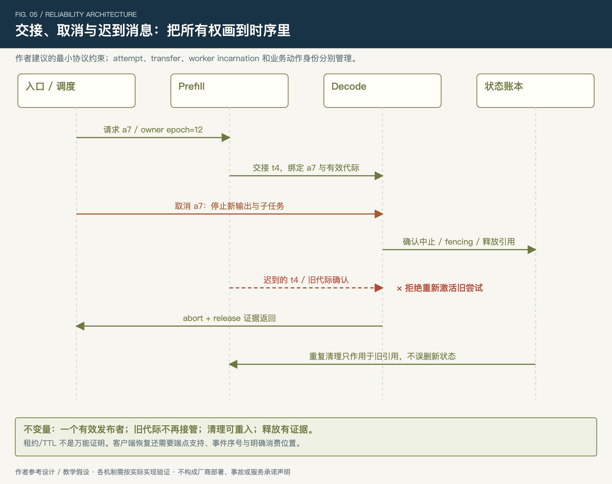

*图 5：示意协议，不限定具体实现。源、目标、状态账本需要对“谁仍有效、谁能输出、谁负责释放”达成一致。*

建议每次交接关联 attempt、transfer、worker incarnation 和 owner epoch。目标接管前检查隔离域、模型、Tokenizer 和状态布局；源端释放需要对应确认或已验证的失效处理流程。

必须维持几个不变量：同一逻辑输出只有一个当前有效发布者；旧代际不能被迟到确认复活；重复清理不释放新尝试的资源；超时表示尚未确认，不能自动解释为执行已停止。

身份字段还需要权威状态转换支撑：接管与取消通过同一权威记录的条件更新互斥提交，或采用具有同等保证的协议；终态不能被迟到确认改回活动态。结果发布路径必须实际校验 fencing，终态和代际记录则要覆盖消息仍可能生效的期限；仅在日志里打印 epoch 没有隔离作用。

fencing 可以阻止旧执行者提交结果，但它本身不保证客户端恰好一次收到流事件。要支持续接，还需要端点明示的恢复协议、事件身份和消费位置；能力未提供时，返回明确部分结果或发起新请求。

### 3. 取消与业务动作分别闭合

取消链应覆盖入口断开、信号传播、引擎中止和资源回收。只记录 cancel_received 不足以证明已停止。Dynamo 的参考取消设计明确区分了信号与引擎职责。[13]

状态回收需要能识别旧引用，并与物理资源对账。租约失效后，先使旧拥有者失去提交资格，再按具体实现确认中止、回收或隔离；不能靠 TTL 一到就让另一份工作与原执行无约束重叠。

外部动作又是独立边界。创建工单、发送通知应分别有首次执行前持久化的动作 ID；业务端幂等判定与提交要可靠关联。提交响应丢失时先查询，一次“查不到”不能证明没执行。无法确认时保留未知状态并进入补偿或人工核对。

**本域反查：** 交接超时后迟到 ACK 会怎样？取消后多久实际停止、释放？旧清理能否误删新状态？需要竞争时序测试和回收证据，而不只是正常路径日志。

## 五、治理域四：容量与路由——故障之后重新计算可行能力

### 1. 四种承诺分别检查

账户配额、吞吐保证或预留、物理隔离、故障冗余，需要分别核对。它们可能在具体产品中组合提供，不能仅凭其中一项推定其余能力。

百炼公开文档就区分了不同限流模式、吞吐预留与独占资源；部分限流模式带有基线承诺，不能笼统说“配额一概不保证吞吐”。[9][10][12]

预留之外的流量也要按实际落点管理。其 PTU 文档说明超额请求可按配置溢出到按量服务，并提供相应溢出标记；溢出后的性能和流控条件可能变化。[11] 方案因此需要明确：降级目标是谁、剩余容量多少、质量与期限是否仍成立、何时停止切换。

这些都是合同与测量问题。专属 GPU、逻辑隔离、跨故障域备用和在途连续性，需要各自证据；没有公开说明的部分应作为待确认项，而不是判断厂商没有实现。

### 2. 路由先筛可行目标，再优化收益

路由硬条件应先检查：执行者代际有效、实例确实就绪、能力与版本兼容、租户隔离满足、资源准入通过。然后才比较预计完成时间、缓存局部性或其他收益。

容量视图要有代际和有效范围；worker 本地硬上限负责防御陈旧预测。发现系统异常时，应预先定义保守运行窗口、允许健康在途继续的条件，以及禁止新增状态扩张的范围。既不能无限 fail-open，也不必机械终止所有已有流。

副本数也要看实际放置：同一机架、网络、存储或控制依赖可能造成共同失效。选主成功、Pod Running、GPU 已分配，都不能直接计为可服务容量；还要完成状态恢复、模型预热和代表性探针。

### 3. 一个贯穿各域的复合故障例子

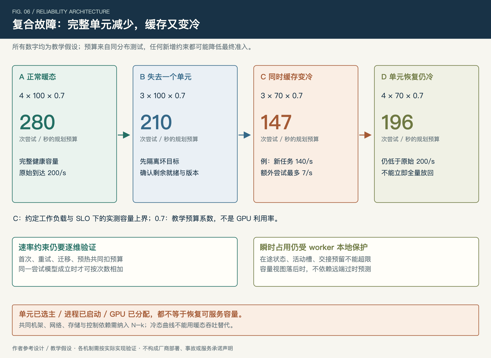

*图 6：全部数字为教学假设。只在相同工作负载与尝试预算下用请求次数简化表示；实际准入仍受每项资源与占用上限约束。*

假设四个完整单元，每单元在约定任务分布和 SLO 下实测容量上界为 100 次尝试/秒。取 0.7 作为规划预算系数，则正常预算 280；失去一个单元后为 210。0.7 是自选吞吐预算比例，不是 GPU 利用率。

若缓存同时变冷，测试得到每单元容量上界降至 70，则三个健康单元只剩 `3×70×0.7=147`。此时可暂按相同成本假设接收 140 次原始请求，最多预留 7 次额外尝试；预热与迁移另有开销时，还需继续降低准入，不能偷偷挤占预算。

恢复第四个单元以后，冷态预算也只有 196，仍低于原始 200 请求/秒。若只看“实例数恢复”立即放回全流量，就可能再次过载。

正确恢复应伴随有效容量更新、受控准入、单层重试预算、真实取消、限速预热及分批放量。队列重新持续增长、旧状态不收敛或分组 SLO 失守时触发停止门；若当前流量已经过载，还需把新增工作及内部恢复流量降回最近已验证的安全预算，重新确认在途与队列收敛。观察窗口按任务生命周期和分组样本预先确定，不能仅停止继续加量。

真实混合负载应按资源约束求可行范围：在测量窗口中，各任务类的进入率乘实测单位需求，不超过相应健康预算；在途状态再受独立占用约束。只有同分布简化场景才使用 `(N−k)C×预算系数`，且不重复扣减已经含余量的 C。

**本域反查：** 能否拿出冷暖、长短及 N−k 容量曲线？备用是否完整就绪？控制面旧视图下谁保护 worker？恢复中的内部流量是否入账？

## 六、治理域五：发布与结果——让回退同时尊重版本与状态

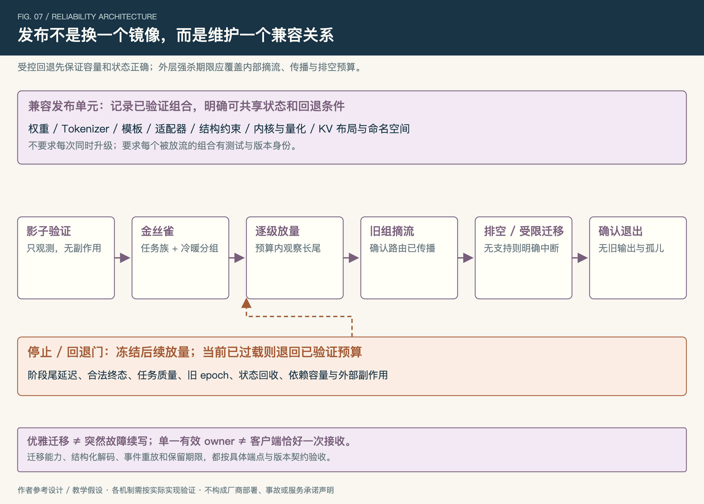

*图 7：新请求回退与在途状态处理分别设计。迁移只在已声明支持的组合与请求类型内进行。*

### 1. 定义兼容单元和可回退边界

发布清单建议覆盖权重、Tokenizer、模板、解析器、结构约束、内核与量化、KV 布局和缓存命名空间。不是要求每次一起升级，而是要求每个组合有验证记录。

先用无真实副作用的影子任务验证，再做金丝雀和分级放量，按模型、任务族、冷热状态观察。旧组退出应先摘流、确认传播，再排空或按能力迁移，最后退出。外层强杀期限必须包含这些阶段。[15]

若失败，应先暂停扩流并检查回退目标的容量和状态兼容。新请求可以改回旧版本，不代表正在生成的状态能原样迁过去。Dynamo 的固定版本迁移文档展示了请求类型及配置限制，可用于说明这类能力需要逐项验证，不能推广成普适无损续写。[14]

### 2. API 名称相似，恢复语义仍要逐项对照

端点能力矩阵至少记录：上下文是否由服务端保存、有效期、是否支持取消、正常与异常终态、usage 到达方式、工具动作由谁执行。

智谱 Responses 公开支持服务端会话存储与 previous_response_id，同时说明默认存储设置、有效期及独立流终态。[8] 这与只在调用方保存历史的接口有不同责任边界。但保存会话不自动代表保存生成执行态，更不能推出工具动作恰好一次。

切换模型或供应方时，应验证上述契约及上下文、工具、结构要求，不能只测试请求 JSON 能发送成功。模型别名变化也需用可观察版本及自有模板版本关联任务评测。

### 3. 完成率分三层，也分责任

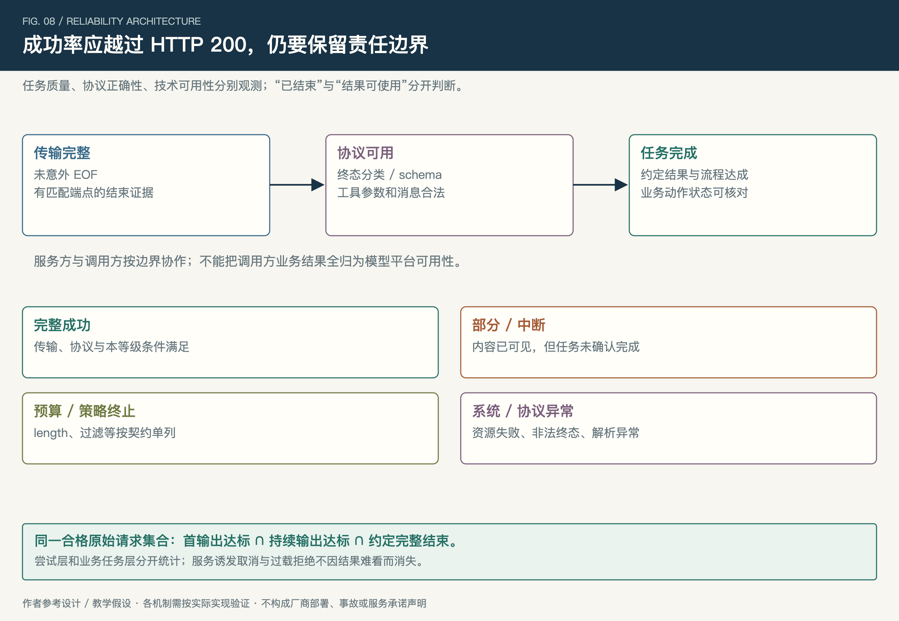

*图 8：服务方技术 SLO 与调用方业务结果协作关联，分别验收，避免相互替代。*

传输完整，意味着没有意外中断；协议完整，意味着合法终态、结构和消息序列满足端点要求；任务完成，还需要约定流程及业务状态正确。

HTTP 200 不能替代这三层判断。DeepSeek 和智谱的公开契约都提供生成结束或异常结果的分类，需要按端点处理。[27][7] 预算耗尽、策略终止、资源失败、工具交接和部分结果应分别计数。

任务质量目标与技术 SLO 也要分开。模型给出的答案未达到业务期望，不全部属于基础设施宕机；反过来，网络正常也不证明协议可用。外部工具的提交状态由实际执行方与业务系统共同保障。

落实到责任人，平台服务负责人承担技术 SLO，模型质量负责人承担能力评测，业务／产品负责人确定并验收任务质量目标；外部动作则由编排方和实际执行系统分别闭合各自状态。每层都要有明确验收人，SRE 协助验证跨层故障。

**本域反查：** 哪些版本组合被放流？灰度是否覆盖长流、结构化和工具轮次？回退会不会破坏在途？协议异常能否在 200 中被识别？要求提供兼容清单、端点矩阵和真实回放。

## 七、共享依赖：GPU 健康，为什么整个 API 仍可能不可用

五个治理域还依赖一组公共服务：身份与授权、租户额度、路由配置、服务发现、用量记录及它们背后的存储和网络。故障可能先表现为鉴权变慢、额度请求超时或路由更新停滞，继而挤占入口连接、拖长队列，再被误判为推理容量不足。

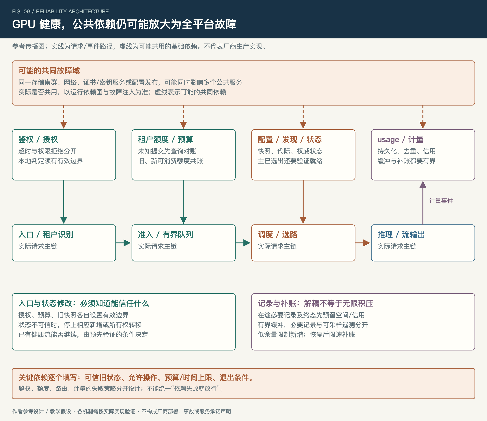

*图 9：虚线表示可能的共同依赖，实线表示请求或事件路径。并非所有服务都应同步阻塞请求；实际部署需标出哪些调用必须成功、哪些允许在已验证边界内延迟。*

### 1. 先判断依赖是拒绝、变慢，还是状态未知

| 共享依赖 | 典型传播路径 | 建议的保护与恢复边界 |
| --- | --- | --- |
| 鉴权、授权、密钥与撤销信息 | 依赖变慢→入口线程／连接等待→全租户超时 | 限制依赖并发与等待；只有预先设计、可验证且满足有效期／撤销要求的本地判定才能继续。无法确认授权的新请求拒绝；不把权限拒绝改成故障放行 |
| 租户额度与准入账本 | 扣额超时→盲目重扣或各节点独立放行→额度超卖 | 对 reservation ID 查询与对账；只消费仍有效、总额受控的已分配预算。未知授权额度不重复发放，耗尽后拒绝新增 |
| 配置、发现和路由状态 | 旧目标仍被选中／新目标尚未就绪→错误重试→健康池过载 | 有界使用已验证旧快照，并由目标代际与本地准入校验；状态失去可信度时停止新增派发，保留满足条件的健康在途 |
| 共享元数据与状态存储 | 选主／失去多数派／写入超时→所有权或额度结果不确定 | 按一致性要求处理，不把超时当作未提交；先确认权威状态与新主可服务，再开放修改所有权或额度的路径 |
| usage、计量和结算管道 | 下游堵塞→同步链路超时；或异步积压→磁盘／内存耗尽 | 异步解耦须有持久记录、幂等与上限；预留在途剩余必要记录及终态的空间／信用。余量不足先停新增，仍不能保全时按契约处置相关在途，不能丢账继续服务 |
| 日志、追踪和监控出口 | 出口变慢→业务同步等待，或无界队列吃光内存 | 明确哪些遥测可采样、哪些记录必须保留；有界缓冲与隔离出口。关键安全／计量记录无法保留时按已声明策略处理 |

外部授权与全局限流应分别定义故障策略。Envoy 的参考实现分别提供相应故障处理开关，说明它们是独立决策；具体平台仍要按授权、信用和容量边界设计，不能统一套用“依赖失败就放行”。[29][30]

一致性存储尤其要区分“服务暂时不可写”和“某笔写入结果未知”。etcd 的公开文档分别说明多数派失效的可用性限制，以及请求超时后操作可能仍已完成的情况。[31][32] 工程建议因此是：所有权、额度与计量的恢复先核对状态，再重放动作；切主成功本身不能证明账本已对齐。

### 2. 将保守运行写成有上限的模式

每个关键依赖都应预先填写四件事：**能信任的旧状态、允许继续的操作、预算／时间上限、退出模式的条件。** 不支持安全降级的路径要明确拒绝，而不是由值班同学临时决定放开。

例如，发现服务短暂失联时，已有连接不一定要立即中断，但新路由只能在旧快照仍有效、目标代际匹配、本地准入可用的范围内进行。额度服务超时则不能复制同一份余额给每个入口节点；已下发额度也必须继续纳入总账。

恢复要经过依赖侧的读写与一致性检查，再逐步解开 API 并发、重放积压和预热预算。入口、重试、补账若同时恢复全速，可能再次压垮依赖；这也是级联故障治理中应控制的放大路径。[28]

**本章反查：** 一个公共依赖能影响多少租户和模型？它超时后新增、在途、状态修改和计量各自如何处理？需要依赖图、故障策略、持久缓冲上限和失联恢复演练，见配套 S01—S04。

## 八、完整处置推演：冷缓存、单元退出与重试同时出现

下面沿用图 6 的容量数字，演示从发现到恢复的决策顺序。**这是作者设计的教学场景与预案，不是厂商事故或实测记录；阶段编号表示先后关系，不承诺固定几分钟恢复。**

前提是：四个完整单元，原始请求到达 200 次／秒；每单元暖态容量上界 100、冷态 70，规划系数 0.7。注入缓存变冷和一个单元退出，并让流量发生器模拟额外 40 次／秒的客户端重试。此时入口面对 240 次外部尝试；若全数派发，将超过三个冷态单元合计 210 次／秒的同分布实测上界，更超过 147 的规划预算。到达量不代表平台应全部接受。

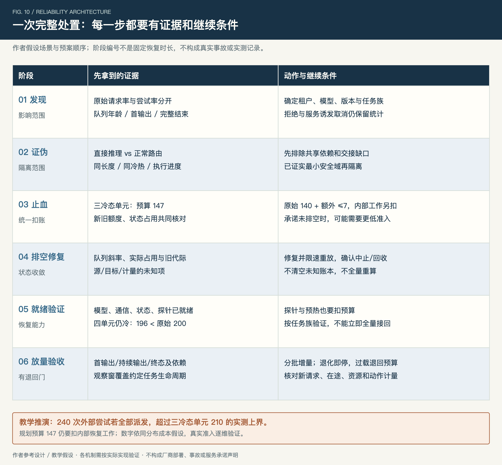

*图 10：每个阶段都要交付证据和继续条件。真实演练需按自己的任务生命周期、负载分布和服务目标填写阈值。*

### 阶段一：确认影响，区分需求与尝试放大

先确认受影响的租户、模型、版本与任务族。观察原始请求率、尝试率、队列最老年龄、首输出分位及完整结束率；不要只看聚合 QPS 或入口 5xx。

此场景要同时看到三条证据链：缓存复用下降使未缓存工作增长；完整可服务单元从四个减少到三个；额外尝试增加了入口需求。被拒绝与服务诱发取消仍计入既定结果口径，不能通过提前拒绝让故障“从统计里消失”。

### 阶段二：证伪邻近原因，再选隔离范围

用同模型、同长度和同冷热条件的探针，对照直接推理与正常路由；检查鉴权／额度依赖、Prefill、交接、Decode 进度和实际单元就绪。

如果直接推理正常、经入口失败，应转查接入或共享依赖；如果 Prefill 已完成而交接未确认，先处理配对与传输。只有确认退出成员使所属通信组不能继续、且没有已验证的局部恢复能力，才摘除该完整单元。证据不支持的扩大重启会损失额外健康容量。

### 阶段三：止血，收紧新增并保住资源控制

先停止故障组的新派发，暂停相关发布和无预算预热。收敛重试责任层，沿用业务关联与总 deadline，每次实际重试使用新的 attempt ID 重新准入；同一预留的查询或重传沿用 reservation ID。对剩余三个单元使用冷态预算，继续核对旧、新额度，不能把旧预留直接遗忘。

在同成本简化模型下，147 可暂分成 140 次原始请求和最多 7 次额外尝试。如果还要给预热划出 10 个等价工作单位／秒，外部预算最多为 137；保留 7 次额外尝试时，原始准入最多 130。这个换算只有在测试已校准内部工作成本时成立，状态占用上限还可能进一步降低准入。

预算之外的请求明确拒绝或按约定降级。运行中的健康请求按优先级、期限与资源策略处理；对已失去完成价值的工作发起取消，并验证引擎中止及回收。不能只发取消信号就把预算当作已经释放。

### 阶段四：排空和修复，防止积压换个地方继续增长

持续检查队列年龄与斜率、活动状态、取消到中止、回收到对账的延迟。暂时过高的在途承诺需要逐步排空；降低新准入不能立即消除已经进入引擎的工作。

缓存侧先区分正常冷态与读故障，仅隔离已确认坏路径。故障单元按受支持流程修复，容量视图完成换代；依赖恢复后也要限速重放积压，避免补账、缓存填充和客户端重试共同占满健康池。

继续条件是：在预设窗口内，队列由积压转为可收敛，实际占用向基线回落，旧代际停止接新工作，状态与计量中的未知项有明确处理路径。若仍持续增长，先继续降新增与内部工作，不等待“机器好了自然恢复”。

### 阶段五：验证就绪，再用预算内探针接流

第四个单元需要完成模型加载、通信初始化、状态恢复与代表性推理；Pod Running 只是一条辅助信号。按约定任务族验证冷暖状态、长流、终态及取消，探针也进入预算。

四个单元都恢复但仍处冷态时，规划预算为 196，仍不足以承载 200 次原始请求再加重试与恢复工作。先恢复了单元数量，不等于恢复了原服务余量。

### 阶段六：分批放量，异常时退回已验证预算

按预先设计的增量与观察窗口调整外部准入，观察分组首输出、持续输出、完整结束、队列、状态回收及共享依赖。缓存回暖后，必须以实际曲线证明预算可以提高，不能仅凭预计命中率提前加流。

队列重新增长、依赖积压加速、协议错误或旧 owner 输出出现时停止扩流；如果当前预算已不可持续，退回最近已验证值。权限、隔离或业务重复动作异常需要直接阻断相应路径，不能等待更多样本。

最终验收分四张账：新请求已在约定范围内稳定服务；在途任务均完成或具有明确终态；计算与状态资源回收；业务动作及 usage／计量可核对。前两项恢复后，后两项仍可能需要限速对账，但必须有责任人、上限与完成条件。

## 九、贯穿能力：让观测、演练和整改形成证据链

### 1. 四组观测就应能串出因果

第一组是入口需求：合格原始请求、尝试率、任务分布和预算。第二组是执行阶段：等待、输入、交接、生成、客户端可见。第三组是状态：占用、所有权、取消、中止和回收。第四组是容量与版本：完整就绪单元、故障域、epoch 和发布批次。

不要把首字节当首模型输出。DeepSeek 文档允许等待期间保活，连接活跃不能证明模型开始生成。[22] 引擎 Token 间隔与客户端 chunk 间隔也要分开，代理可以合并或缓冲事件；参考引擎指标可帮助定义语义，但名称依版本而变。[18]

原始请求、底层尝试与调用方业务任务使用不同分母。服务诱发取消、过载拒绝和降级不能在故障后自动消失；不合格参数与策略结果则按预先定义单列。服务方看其可识别的合格请求，调用方再关联业务任务，不假设平台天然拥有完整业务视图。

### 2. 演练必须包含恢复中的竞争

建议先做两项高价值演练。

**冷态＋完整单元退出：** 先测基线，再依次改变复用和健康容量，观察预算更新、拒绝、重试、预热与放量顺序。验收队列可收敛、任务结果明确、内部流量未旁路、恢复容量真实就绪。

**交接取消＋迟到确认＋实例换代：** 延迟一个 transfer，取消父请求，再释放旧 ACK，并让同一物理节点的新 incarnation 接新任务；再覆盖取消与接管并发提交的竞争。验收权威状态只提交一个有效结果、旧输出不复活、旧清理不误删新状态、无孤儿计算；用户看到部分或取消结果，而不是被伪造成功。

演练应在授权隔离环境进行，有负载上限和停止条件。单独注入一项故障通过后，再组合相关条件，避免一开始随机叠加而无法解释原因。

### 3. 组织一轮能产出整改的架构反查

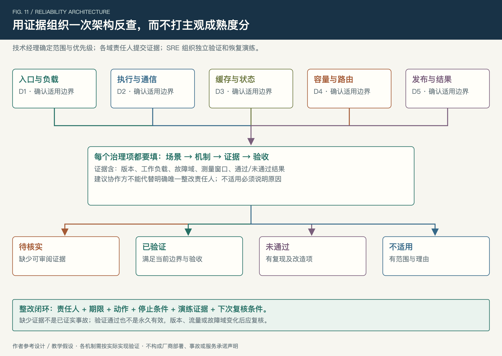

*图 11：缺证据是待核实，不是已发生缺陷；已验证也只在指定版本、工作负载和故障域内成立。*

技术经理先确定服务范围与责任边界，再由五域责任人提交机制、测量和演练材料，SRE 组织交叉验证。每项记录适用范围、机制位置、证据版本、验收、整改责任人与期限。

状态只用待核实、已验证、未通过、不适用四种；不适用必须说明理由，不用缺乏测量依据的成熟度评分。整改优先考虑会扩大故障域、制造重复副作用、失去资源控制或无法验收恢复的路径。

配套[《稳定性架构反查表》](stability-audit.md)给出了 36 项问题和证据要求，可以直接作为会议底稿。一次反查的产物应是带验证条件的治理清单；首次缺失的容量或演练证据，应落实补证计划，保持待核实，不能为了结项改写成已通过。

## 十、现场速查：典型问题、快速排查与止血动作

下面是作者整理的参考处置表。**快速排查用于缩小范围，止血用于限制损失；两者都不等于已证明根因。** 动作先限定模型、租户、版本、通信组或依赖作用域，优先选可回退的控制；禁止在前提未知时把重启、清缓存、放行鉴权或全量切换作为统一答案。

### 1. 请求、推理与状态

| 典型问题 | 快速排查：优先看什么证据 | 快速止血：先做什么 | 适用条件、后续恢复与对应反查 |
| --- | --- | --- | --- |
| F01　QPS 不变，首输出与队列年龄上涨 | 原始／尝试率、未缓存 Token、输入分布、阶段等待；同长度冷热对照 | 限制重输入与额外尝试，按实测冷态预算准入；队列限龄 | 先排除鉴权／额度依赖慢；恢复按队列、状态和分组 SLO。A01、A04 |
| F02　429 激增，客户端越重试越失败 | 端点、业务码、账户作用域；区分余额、租户限额与平台过载 | 永久账户问题停止自动重试；暂态问题按责任层、期限和工作预算退避 | 平台过载才按资源保护处理；不能通过换 Key 绕过账户范围。A05、A06 |
| F03　输入已处理，迟迟没有首生成 | 采用 P/D 分离先看 transfer；交接已确认或未分离时看 Decode 排队／首步 | 隔离已确认坏配对／路径或限制对应生成池的新工作；替代目标须就绪 | 未确认交接先查权威状态；重算需预算，不能释放仍被引用的源状态。B04、C04 |
| F04　生成间隔变大，但平均 GPU 看似正常 | 引擎步时、慢 rank、专家分布、通信等待，与客户端 chunk 对照 | 保护在途、降低新增长生成；隔离已确认坏路径或按有效配置调整热点 | 以任务尾延迟验证改进；发现是代理缓冲则转查接入。B03、B05 |
| F05　单卡异常或整个通信组无进展 | 硬件事件、成员关联、组进度；局部恢复是否经验证 | 先摘除最小安全域的新派发；局部不可恢复且组停滞时摘整单元 | 剩余容量必须重算；按支持流程修复、预热、探针后接流。B02、D01 |
| F06　缓存命中骤降或出现读取失败 | 输入／版本指纹、正常 miss 与读错误、索引和实际副本 | 隔离已证实坏读路径；限制重算、预热和新增输入 | 正常冷态按预算运行；隔离正确性可疑时阻断相关复用。C01—C03 |
| F07　客户端断开后显存、活动槽仍不下降 | disconnect→signal→engine stop→reclaim；owner、attempt 与旧引用 | 阻止过期尝试继续派发／输出，传播取消并限制新占用 | TTL 不证明已停；无法确认停止时保守隔离，凭回收证据归还预算。C04、C05 |
| F08　HTTP 200，但流截断、结构非法或工具动作重复 | 终态、schema、parser 版本、动作 ID 和实际提交状态 | 明确部分／异常结果，暂停有风险的动作重放，按兼容边界回退 | 先查询未知动作；一次查不到不证明未提交。C06、E04、E05 |

### 2. 发布、共享依赖与恢复

| 典型问题 | 快速排查：优先看什么证据 | 快速止血：先做什么 | 适用条件、后续恢复与对应反查 |
| --- | --- | --- | --- |
| F09　发布后仅某类长流或工具请求失败 | 权重／模板／Tokenizer／parser／KV 组合与任务分组，比较旧批次 | 暂停放量，新请求退到兼容且有容量的目标；待退出的故障批次先摘流再排空 | 保持已验证回退目标可服务；在途迁移需明确支持，不把回退视为无损续写。E01—E03、E06 |
| F10　鉴权慢或故障，入口连接积压 | 授权拒绝与依赖错误分别计数，验证密钥／撤销信息新鲜度及依赖等待 | 限制鉴权依赖并发和等待；无法确认授权的新增请求拒绝 | 只有经设计验证的本地授权模式可继续；禁止临时关闭鉴权。S01 |
| F11　扣额超时、重复预留或额度服务失联 | reservation ID、权威提交状态、新旧分配额度、重复释放 | 停止重扣和无依据补发；只消费可确认有效的已分配预算 | 未知提交先查询对账；预算耗尽停止新增，恢复后防积压全速重放。A02、S02 |
| F12　发现／配置失联，路由仍指向旧实例 | 快照年龄、epoch、worker incarnation、readiness 与目标本地准入 | 隔离已确认陈旧目标；仅在有效快照与目标校验范围内继续 | 失去可信路由时停新增派发；健康在途按条件保留，不盲目清空全局发现。D03、S03 |
| F13　状态存储选主／失去多数派，写入结果不明 | 多数派与领导权、写 ID、提交／恢复状态，调用是否要求强一致 | 暂停无法确认的所有权转移和额度修改；有界保护健康在途 | 按存储受支持恢复流程确认权威状态；不跳过一致性或盲目重放未知写入。C02、S02、S03 |
| F14　usage／计量消费落后，业务仍在生成 | 生产消费差、最老记录、缓冲／信用余量，含在途剩余及终态预留 | 限速内部工作、停止越界新增；保留必要记录，仍不足则按契约处置对应在途 | 有界持久缓冲及预留成立才允许延期；恢复后去重补账，不能丢账清积压。S04 |
| F15　日志／追踪堵塞拖慢推理服务 | 请求是否同步等待出口、发送队列、内存与磁盘水位 | 隔离出口、限制队列，对允许降采样的遥测降采样 | 安全、动作和计量等必要记录单独保护；恢复按出口余量回放。S04、X01 |
| F16　实例全恢复，一放流又过载 | 冷暖容量、就绪探针、旧预留、重试与预热预算、占用 | 退回已验证安全预算，限制内部恢复工作；重新确认队列收敛 | 以实际曲线、在途及依赖状态决定加流，不能只数 Pod／GPU。D02、D05、D06 |

建议值班预案在这些参考行上补充：本服务的观察入口、负责人、已批准控制开关、预设阈值和回退目标。通用表提供决策顺序，实际操作仍由当前版本与证据限定。

## 结语

一套稳定性架构应当让负责人说清：哪些工作可以进入，哪些状态仍被持有，一次故障会失去哪些能力，以及恢复中的每一步凭什么继续。

围绕这几个对象建立预算、所有权、隔离、版本与验证机制，才能使局部异常有边界、恢复有条件、治理有证据。公开案例帮助我们理解取舍；自身测试和运行事实决定方案是否成立。

## 附录：术语与阅读提示

| 术语 | 本文中的含义与容易混淆之处 |
| --- | --- |
| Prefill／Decode（P/D） | 前者处理输入上下文，后者逐步生成输出。阶段可以由同一实例承担；分离部署才需要额外交接协议 |
| Token／KV Cache | Token 是模型处理单元；KV Cache 是注意力计算的中间状态。Token 速率与状态占用字节是两类预算 |
| 前缀缓存／会话态／执行态 | 分别指复用输入计算、保存历史会话、持有正在生成的中间态；其中一种可用不证明另两种可恢复 |
| TTFT／ITL／chunk | 首模型输出延迟、引擎 Token 间隔、传给客户端的内容块。保活不计首模型输出，chunk 可被缓冲或合并 |
| SLI／SLO／SLA | 观察指标、服务目标和正式服务承诺。本文自选的教学阈值不能当作厂商 SLA |
| P99／分组（cohort） | 分位统计及按任务、模型、版本等划分的观察集合。平均值或全局分位可能掩盖小组异常 |
| Goodput | 满足预先定义质量／时延等条件的有效完成吞吐；不等于收到多少请求或产生多少 Token |
| 工作预算／占用租约 | 一段时间允许进入多少计算或传输工作，与同一时刻可持有多少槽位／状态；需要分别限制与对账 |
| Deadline | 一项工作的总截止时间。跨队列、调用与重试传递剩余期限，不能每一跳重置完整超时 |
| 业务任务／request／attempt | 调用方要完成的事、一次 API 调用、一次实际执行尝试；重试会产生新尝试，不一定是新业务任务 |
| Reservation ID／transfer ID | 标识一次资源预留或状态传输；用于响应丢失后的查询、去重和对账，不能互相代替 |
| Worker incarnation | 执行实例的一次具体生命期。同机器、同地址进程重启后也需要区分新旧执行者 |
| Owner epoch／fencing | 所有者代际，以及在实际输出／提交点拒绝旧代际的机制；打印编号本身没有隔离效果 |
| 权威条件更新 | 按已确认的当前状态执行条件提交，例如仅允许有效 owner 从活动态转换；竞争操作不能各自都判成功 |
| Lease／TTL | 有效期安排，不是物理计算停止或旧消息消失的证明；失效还需 fencing、清理和资源对账 |
| Rank／MoE／EP | 并行成员、混合专家模型、专家并行。慢成员或专家热点可能拖慢同步组，隔离范围依具体通信关系 |
| 故障域／完整服务单元 | 可能共同失效的范围，以及能独立完成目标服务的资源组合；不是固定等于一张卡、一台机器或一个 Pod |
| N−k／冷态与暖态 | 失去 k 个完整单元后的承载条件，以及缓存／加载／预热状态。单元数量相同也可能有不同可服务能力 |
| 控制面／数据面 | 维护配置、发现、容量等决策状态，与实际承接并执行请求的路径；二者可能共享依赖，需实际画图 |
| Fail-open／fail-closed | 依赖失效时继续允许或拒绝特定操作。必须说明对象、可信状态和上限，不能全平台统一套用 |
| 背压／有界缓冲 | 下游消费变慢时限制上游速度，并限制排队量／时间，避免积压无限消耗内存、磁盘或计算 |
| 排空／迁移／重试 | 让现有工作结束、转移有效执行状态、重新发起尝试；三种动作的状态和输出语义不同 |
| 幂等／恰好一次 | 重复同一动作不重复产生效果，以及某边界内的唯一处理／交付语义；需要声明边界，不能由请求 ID 或消息去重单独推导 |
| PTU／DTU／吞吐预留 | 本文引用产品的不同资源模式，具体含义以各自契约为准；额度、吞吐、隔离和故障冗余分别验证 |

---

## 参考资料

编号在配套《公开资料与适用边界》中给出逐项说明，以下为本文直接使用的一手资料。滚动文档以发布或调用时契约为准。

1. Mooncake 原始论文，v5，2026-10-08：<https://arxiv.org/abs/2407.00079v5>
2. Mooncake Store 设计，固定 commit：<https://github.com/kvcache-ai/Mooncake/blob/868a6d05abf904975840c7e0487dc256af5491d0/docs/source/design/store/mooncake-store.md>
3. DeepInfer 公开范围：<https://github.com/deepseek-ai/DeepInfer>
4. DeepInfer 部署问答，v0.2，2026-11-03：<https://github.com/deepseek-ai/DeepInfer/blob/a679bb86ce36e883a98a97733492b686e5b9a08e/doc/inference_deployment_qa.md>
5. Kimi 错误契约：<https://platform.kimi.ai/docs/api/errors.md>
6. Kimi 上下文缓存：<https://platform.kimi.ai/docs/guide/context-caching.md>
7. 智谱错误与业务码：<https://docs.bigmodel.cn/cn/api/api-code>
8. 智谱 Responses：<https://docs.bigmodel.cn/cn/guide/develop/responses/introduction>
9. 百炼限流：<https://help.aliyun.com/zh/model-studio/rate-limit>
10. 百炼吞吐预留：<https://help.aliyun.com/zh/model-studio/tpm-reservation>
11. 百炼 PTU 及溢出：<https://help.aliyun.com/zh/model-studio/ptu-long-input-and-cache>
12. 百炼 DTU：<https://help.aliyun.com/zh/model-studio/dtu-model-deployment>
13. Dynamo 取消架构，v1.6.1：<https://docs.nvidia.com/dynamo/v1.6.1/knowledge-base/concepts/fault-tolerance/request-cancellation-architecture>
14. Dynamo 请求迁移，v1.6.1：<https://docs.nvidia.com/dynamo/v1.6.1/kubernetes/fault-tolerance/request-migration>
15. Dynamo 优雅退出，v1.6.1：<https://docs.nvidia.com/dynamo/v1.6.1/kubernetes/fault-tolerance/graceful-shutdown>
16. Google SRE，Handling Overload：<https://sre.google/sre-book/handling-overload/>
17. DistServe，OSDI 2024：<https://arxiv.org/abs/2401.09670>
18. vLLM Production Metrics：<https://docs.vllm.ai/en/stable/usage/metrics/>
19. DeepEP：<https://github.com/deepseek-ai/DeepEP>
20. EPLB：<https://github.com/deepseek-ai/EPLB>
21. Recipe（协议处理补充）：<https://github.com/deepseek-ai/deepseek-recipe>
22. DeepSeek 排队与保活契约：<https://api-docs.deepseek.com/quick_start/rate_limit/>
23. DeepSeek Responses（端点对照补充）：<https://api-docs.deepseek.com/guides/responses_api/>
24. Kimi 多维限额（入口反查补充）：<https://platform.kimi.ai/docs/pricing/limits.md>
25. 智谱缓存字段：<https://docs.bigmodel.cn/cn/guide/capabilities/cache>
26. Mooncake Transfer Engine（通信恢复补充）：<https://github.com/kvcache-ai/Mooncake/blob/main/docs/source/design/transfer-engine/index.md>
27. DeepSeek Chat 完成语义：<https://api-docs.deepseek.com/api/create-chat-completion/>
28. Google SRE，Addressing Cascading Failures：<https://sre.google/sre-book/addressing-cascading-failures/>
29. Envoy 外部授权故障策略：<https://www.envoyproxy.io/docs/envoy/latest/configuration/http/http_filters/ext_authz_filter>
30. Envoy 全局限流故障策略：<https://www.envoyproxy.io/docs/envoy/latest/configuration/http/http_filters/rate_limit_filter>
31. etcd 失效模式，v3.6：<https://etcd.io/docs/v3.6/op-guide/failures/>
32. etcd API 保证，v3.6：<https://etcd.io/docs/v3.6/learning/api_guarantees/>
